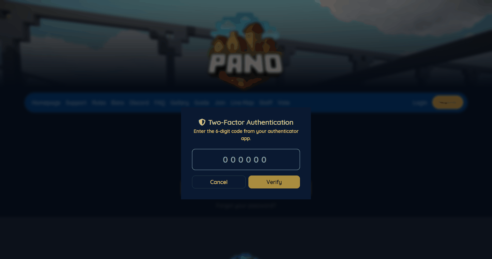
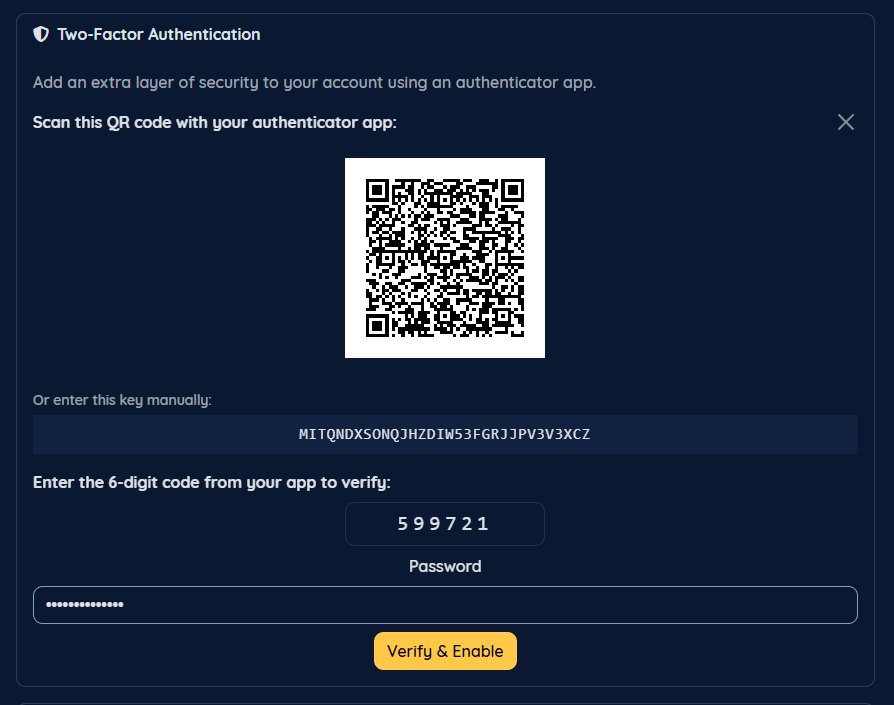
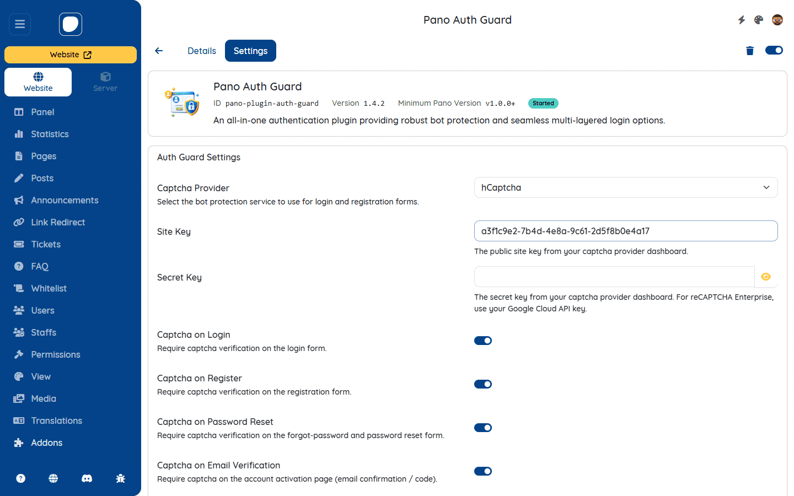

  
  <h1>Auth Guard</h1>
  
<b>Stop bots and protect every player account with captcha, 2FA and email sign-in links.</b>

  

    
    
    
  

Auth Guard keeps bots and account thieves away from your Pano website. Add a captcha to your sign-in and sign-up forms, let players protect their accounts with an authenticator app, and offer password-free sign-in with a one-time email link. Every feature is a simple switch in your panel.

## ✨ Features
- 🤖 **Bot protection**: Add a captcha from popular services like Google reCAPTCHA or hCaptcha to stop spam sign-ups.
- 🎯 **You choose where**: Turn the captcha on or off for sign-in, sign-up, password reset and email confirmation.
- 🔐 **Two-factor authentication**: Players secure their account with any authenticator app by scanning a QR code.
- 🏷️ **Your name in the app**: Codes show up under your server's name in the player's authenticator app.
- ✉️ **Magic login links**: Players sign in with a one-time link sent to their email, no password needed.
- ⏱️ **Links that expire**: Choose how many minutes a sign-in link stays valid.
- 🛠️ **Help for locked-out players**: Staff can check and remove a player's 2FA from the player page.
- 📋 **Activity log**: Settings changes and 2FA changes are recorded in your panel logs.

## 📸 Screenshots

<i>Players turn on two-factor authentication from their account settings in a few seconds.</i>

<i>Pick a captcha service and switch features on from one settings page.</i>

## 🚀 Get started
1. Open your Pano panel and go to **Addons**.
2. Find **Auth Guard** and click **Install**.
3. Open the addon's **Settings** tab and switch on the protections you want.

## 💬 Support
Questions or ideas? Join our [Discord](https://panomc.com/discord) or visit [panomc.com](https://panomc.com).

## 📄 License
Released under the MIT License.
